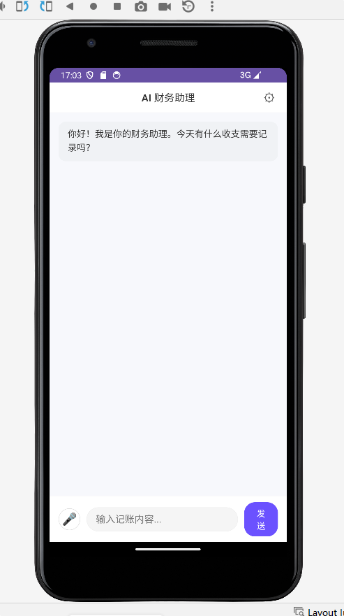
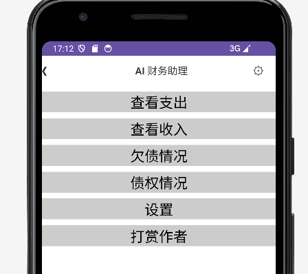
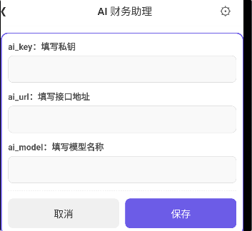
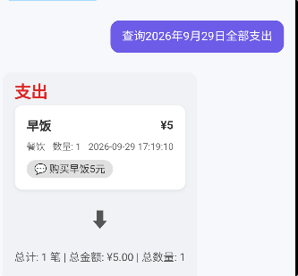
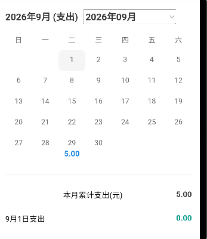
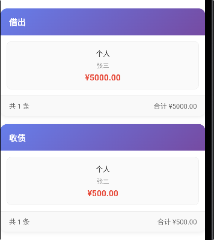

# AI 财务助手（暂定名:‌会意）

> 像微信聊天一样记账：说一句"今天买菜花了 20"，AI 自动帮你记好每一笔流水。

一款主打**语音 / 一句话记账**的 Android 财务助手。无需在微信、支付宝、各家银行卡之间反复切换填表，也不用面对复杂的分类和报表——只想清楚"每天花了多少钱、还有谁欠我钱"，它就是为你设计的。

> 说明：软件正式名称尚未确定，文中统一以「AI 财务助手」代称。

---

## 目录

- [为什么做它](#为什么做它)
- [核心特性](#核心特性)
- [软件架构](#软件架构)
- [技术栈](#技术栈)
- [安装教程](#安装教程)
- [使用说明](#使用说明)
- [软件截图](#软件截图)
- [已知问题与迭代记录](#已知问题与迭代记录)
- [参与贡献](#参与贡献)
- [开源协议](#开源协议)

---

## 为什么做它

灵感来自一个很朴素的念头：某天突然想记录一下自己的消费流水，于是冒出"能不能让 AI 帮忙记账"的想法。先和 AI 把整体架构讨论了一遍，发现**完全可行，而且实现难度不大**，于是动手。

为了验证需求，我找到家里"掌管财务大权"、持有初级会计资格证书的爱人做了行业调研，结论非常直接：

- **输入太重**：传统 App 每次记账要选微信 / 支付宝 / 工行 / 建行……一堆账户，还要把"从哪儿花的"填清楚。而普通人只想记"花了多少钱"，根本不想知道也不必被 App 管着钱存在哪、怎么花。
- **不需要专业报表**：用户只想最后看一眼"每天花了多少"，复杂的财务报表反而是负担。
- **隐私敏感**：我的钱存在哪、怎么花，是我自己的事，不需要告诉 App。

这三点，正是本项目的设计出发点：**简洁、灵活、快速**——用一句简单的自然语言描述，交给 AI 分析语境完成记录，把记账成本压到最低。

---

## 核心特性

- **一句话 / 语音记账**：像发微信一样说一句"今天买菜花了 20"，AI 自动从日常口语中提取金额、用途等信息，按指定格式结构化输出，无需手动选账户、填分类。
- **AI 语境解析**：调用大模型（网络或本地，按需自选）从用户对话中严格提取指定字段。本地大模型方案兼顾**隐私**——你的钱存在哪、怎么花，可以完全不出本机。
- **先确认后入库**：AI 解析结果先回显给用户，用户**可修改、可放弃、可确认**，确认后才写入数据库，杜绝"记错账"。
- **债权债务直观管理**：将**贷款、还款、借出、收回**与普通的收入、支出**分开记录、分开查看**，一眼就能看出"谁还欠我钱、我还欠谁钱"，时间一长也不会忘。
- **轻量流水账定位**：不做专业财务报表，聚焦"每天花了多少、还剩多少、谁欠谁"这类最真实的需求。
- **离线语音（可替换）**：内置 Vosk 离线语音识别，不依赖云端即可语音输入；识别精度不足时可按需替换为其他 ASR 方案。

---

## 软件架构

整体采用「**原生后端 + Web 前端 + 本地数据库**」的混合结构：

```
用户（文字 / 语音输入）
        |
        v
  Android Studio（Java 后端）
        |-- 语音：Vosk 离线识别（可替换）
        |-- 调用 AI 大模型 API（网络 / 本地不限）
        |     从口语对话中严格提取指定字段
        v
  Java 后端将结果分解重组为 JSON
        |
        v
  前端 UI（HTML + CSS + JS）渲染解析结果
        |  用户查看 / 修改 / 确认是否记录
        v
  确认后数据回传后端 -> 写入 SQLite 本地数据库
```

设计要点：

1. 通过 API 调用 AI 大模型（网络、本地均可），从用户日常对话中**严格提取指定值**，并按指定格式输出。
2. Java 后端把提取结果**分解、重组为 JSON** 发送给前端渲染。
3. **用户决定是否记录该信息**（记录前可修改）。
4. 用户确认后，数据返回后端写入数据库。
5. 语音使用 Vosk（性能存在不足，可按自己需求自行替换）。
6. 其他业务逻辑（如债权债务、查询统计）均遵循上述同一条"输入 → AI 解析 → 确认 → 入库"的路径。

---

## 技术栈

| 层次 | 选型 | 说明 |
|------|------|------|
| 客户端 | Android（Java） | Android Studio 开发，后端逻辑主体 |
| 前端 UI | HTML + CSS + JavaScript | 以 WebView 方式渲染交互界面 |
| 数据库 | SQLite | 本地存储，隐私不出设备 |
| AI 能力 | 大模型 API（网络 / 本地不限） | 语境解析、字段提取 |
| 语音识别 | Vosk（离线） | 可替换为其他 ASR 方案 |

---

## 安装教程

> 以下为通用 Android 项目构建步骤，具体依赖版本以仓库配置为准。

1. 克隆仓库：

   ```bash
   git clone https://gitee.com/abc62201/ai_ledger.git
   ```

2. 使用 **Android Studio** 打开项目根目录，等待 Gradle 同步完成。
3. 在 `ai_config` 等配置中填入你使用的 **AI 大模型 API Key / 地址 / 模型名**（支持本地大模型），以及按需配置 Vosk 语音模型。
4. 连接 Android 设备或启动模拟器，点击 **Run** 构建安装。

> 提示：本项目随版本迭代存在数据库结构升级逻辑（`onCreate` / `onUpgrade`），升级时会自动补建缺失表（如 `ai_config`），首次运行即完成初始化。

---

## 使用说明

1. **记一笔**：进入 App 后，用一句话或语音说出消费，例如"今天买菜花了 20""上周工资到账 5000"。
2. **AI 解析确认**：App 自动提取金额、用途等信息并展示，你可修改或放弃，确认后点击记录。
3. **查看流水**：随时查看每天的收支流水，了解"花了多少、还剩多少"。
4. **债权债务**：在独立视图中查看**贷款、还款、借出、收回**，清晰掌握"谁欠我、我欠谁"。
5. **语音输入**：可直接对内置 Vosk 说话；若识别不准，可改用输入法自带的语音输入功能。

---

## 软件截图

## 菜单

## 填写api

> 以下为 AI 财务助手的部分界面截图，展示记账、查询、日历、打赏等核心功能。
### 记账界面


### 查询界面



### 日历显示



### 债权关系



### 用户打赏

<div style="display: flex; gap: 20px; align-items: center; justify-content: center;">
  
  
</div>


---

## 已知问题与迭代记录

项目以"够用的流水账"为定位，迭代中如实记录了以下取舍与问题：

- **语音识别精度有限**：Vosk 存在把"今年一共花了多少钱"识别成"今天一共花了多少钱"这类误差。当前曲线方案是使用输入法的语音输入；长期方案可替换为更准确的 ASR（含付费 API）。
- **债权债务表达方式**：曾讨论过"还款 / 借出是否直接计入支出"。经与持证的财务使用者及一位 70 多岁国企退休老会计交叉验证后，最终决定将**贷款、还款、借出、收回**与普通收支**分开记录与查看**——分类名称写清楚便于查询，同时保证"谁欠我钱"这类信息能直观呈现。
- **开发节奏**：约 2 周完成收入 / 支出基本功能并投入首轮测试；随后历时约 3 周，从语音输入、字段提取、数据库结构与升级兼容，到本地大模型与语音 API 方案落地，逐步跑通稳定运行。

---

## 参与贡献

1. Fork 本仓库
2. 新建 Feat_xxx 分支
3. 提交代码
4. 新建 Pull Request

欢迎围绕以下方向提 Issue 或 PR：语音识别准确率、AI 解析字段的鲁棒性、债权债务 UI 直观性、本地大模型接入等。

---

## 开源协议

本项目采用开源方式发布，具体许可证以仓库根目录 `LICENSE` 文件为准。建议在正式开源前补充 LICENSE（如 MIT / Apache-2.0）以明确使用与分发条款。

---

> 本项目源于一个"让 AI 帮忙记账"的朴素想法，核心目标是把记账这件事做得像聊天一样简单。如果你觉得有用，欢迎 Star 与共建。
